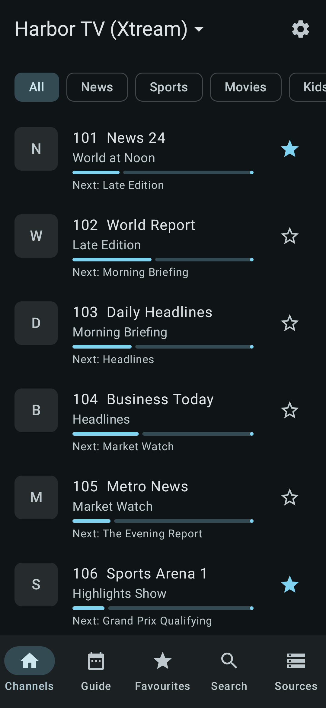
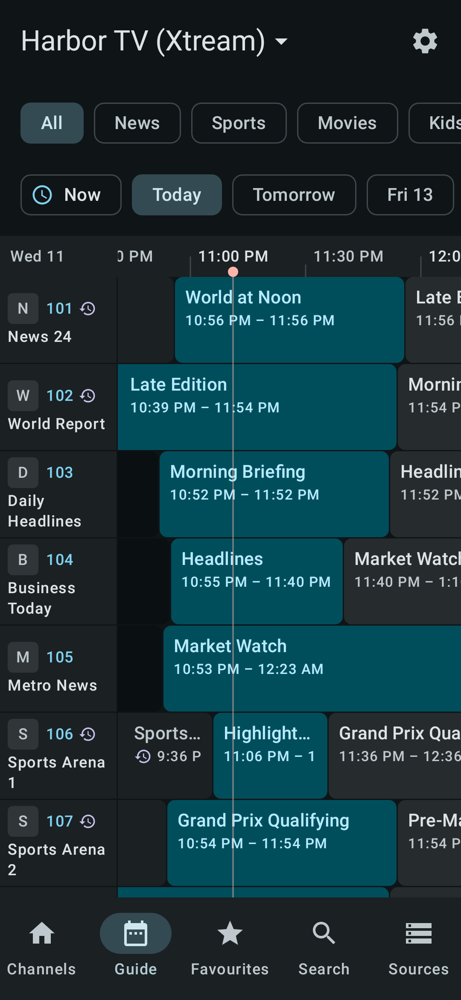
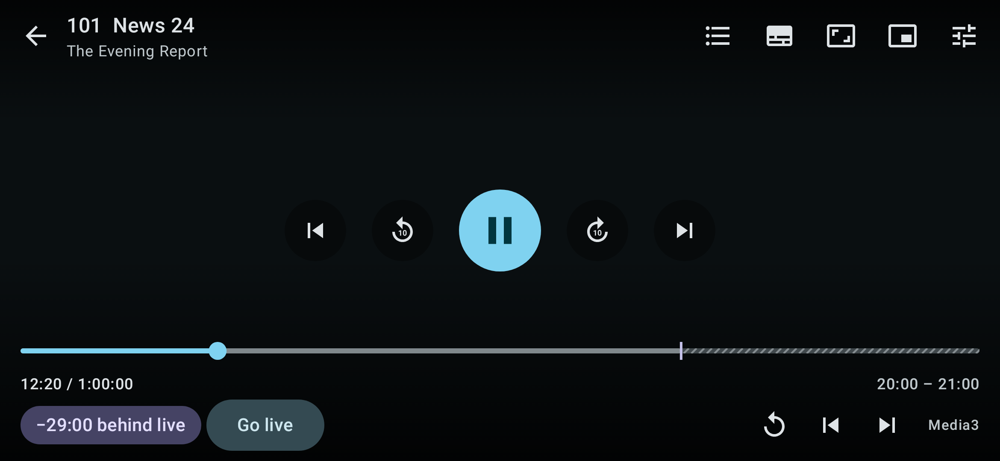
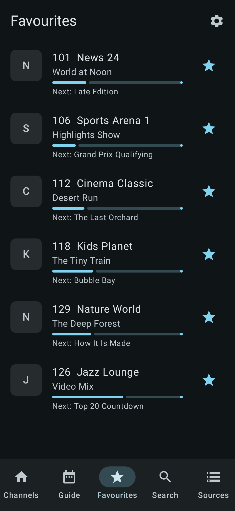
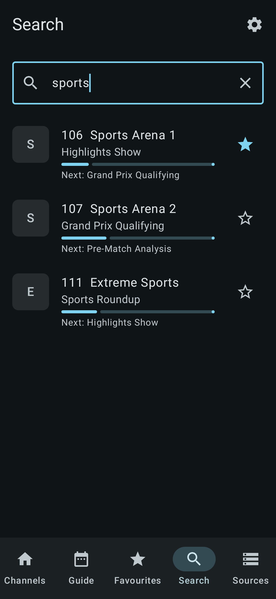
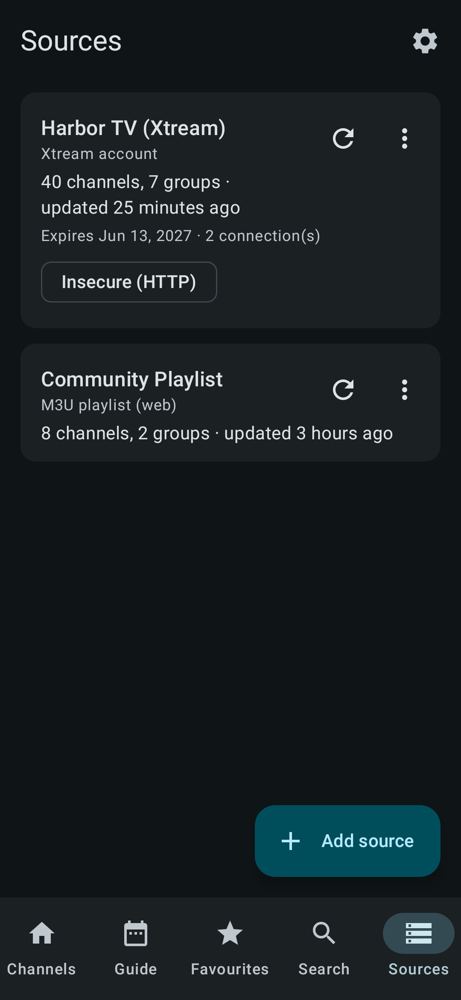
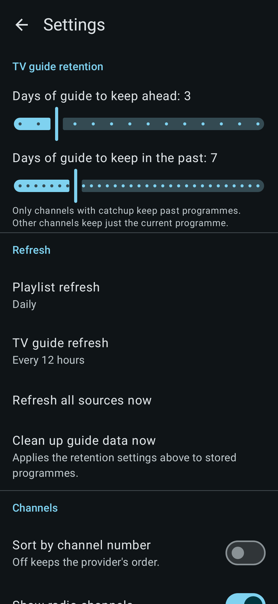

# IPTV

A native Android IPTV player built with Kotlin and Jetpack Compose. Add your own
playlists, browse channels, follow the programme guide and watch live or catch-up
streams.

> This app ships **no channels or content**. You supply your own sources and are
> responsible for having the right to use them.

## Features

- **Sources:** M3U/M3U8 playlists (URL) and Xtream Codes accounts, with XMLTV guide data.
- **Channels:** browse by category, search, and mark favourites.
- **Programme guide (EPG):** scrollable timeline grid with a "now" marker, programme details, portrait and landscape layouts, and configurable guide retention.
- **Player:** Media3 ExoPlayer (HLS, DASH, RTSP, RTMP) with FFmpeg decoder and libVLC engines, background playback service, and Picture-in-Picture.
- **Catch-up / timeshift:** catch-up URL templates, Xtream and Flussonic-style rewriting.
- **Background sync:** WorkManager imports of large playlists and guides, with download caps and safe failure handling.

## Screenshots

| Channels | Guide | Player |
| --- | --- | --- |
|  |  |  |

| Favourites | Search | Sources | Settings |
| --- | --- | --- | --- |
|  |  |  |  |

More: [guide (landscape)](screenshots/guide_landscape.png), [programme details](screenshots/guide_programme.png).

## Requirements

- JDK 17
- Android SDK (compile/target SDK 36)
- Device or emulator running Android 7.0 (API 24) or newer

## Project structure

| Module | Contents |
| --- | --- |
| `core` | Platform-independent logic: models, URL and scheme utilities, catch-up URL building, EPG matching, secret redaction. |
| `app` | Android app: Compose UI (`ui/`), Room database and repositories (`data/`), importers and workers (`sync/`), playback (`player/`), dependency wiring (`di/`). |

Releases are built by the manually triggered workflows in `.github/workflows/`
(`release-apk.yml`, `play-release.yml`), which require signing secrets.

## License

Licensed under the [GNU General Public License v3.0](LICENSE).
